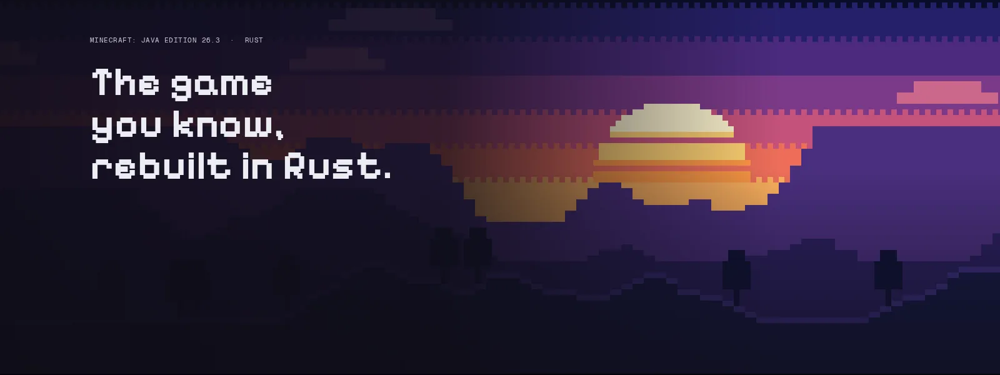

<p align="center">
  
</p>

<p align="center">
  <a href="https://github.com/CodingM-eng/CREW-Client/actions/workflows/ci.yml"></a>
  
  
  
  
  <a href="https://youtube.com/@CREWNW"></a>
  <a href="LICENSE"></a>
</p>

<p align="center">
  <a href="https://client.crewnetwork.space/"><b>🌐 Resmi Web Sitesi</b></a> ·
  <a href="https://client.crewnetwork.space/indir/"><b>⬇️ İndir</b></a> ·
  <a href="https://youtube.com/@CREWNW"><b>📺 YouTube Kanalı</b></a> ·
  <a href="https://client.crewnetwork.space/surumler/"><b>📜 Sürüm Notları</b></a> ·
  <a href="https://client.crewnetwork.space/dokumanlar/"><b>📖 Dokümantasyon</b></a> ·
  <a href="https://discord.gg/crewnetwork"><b>💬 Discord</b></a>
</p>

---

# CREW Client

**CREW Client**, **CREW Network** tarafından rekabetçi PvP oyuncuları ve performans tutkunları için geliştirilmiş modern, hafif ve Türkçe Minecraft istemcisi ve başlatıcısıdır.

Açık kaynak kodlu Horizon projesinin yüksek performanslı yerel motorunu temel alarak; Fabric 1.21.11 ekosistemi, resmi Microsoft yetkilendirmesi, Modrinth mod entegrasyonu ve CREW Network sunucusuyla (`oyna.crewnetwork.space`) tam uyumlu hale getirilmiştir.

> [!NOTE]
> CREW Client bağımsız bir açık kaynak projesidir ve Mojang Synergies AB veya Microsoft ile resmi bir bağlantısı bulunmamaktadır. Minecraft, Mojang Synergies AB'nin tescilli ticari markasıdır.

---

## İçindekiler

1. [Proje Tanıtımı](#1-proje-tanıtımı)
2. [Hızlı Bağlantılar](#2-hızlı-bağlantılar)
3. [Mimari Ayrım: Native Rust İstemcisi vs Fabric JVM Başlatıcısı](#3-mimari-ayrım-native-rust-istemcisi-vs-fabric-jvm-başlatıcısı)
4. [Öne Çıkan Özellikler](#4-öne-çıkan-özellikler)
5. [Sistem Gereksinimleri](#5-sistem-gereksinimleri)
6. [İndirme ve Kurulum](#6-indirme-ve-kurulum)
7. [Microsoft Hesabı Girişi & OAuth Kurulumu](#7-microsoft-hesabı-girişi--oauth-kurulumu)
8. [Çevrimdışı (Offline) Mod Kullanımı](#8-çevrimdışı-offline-mod-kullanımı)
9. [CREW Network Sunucusu ve Çok Oyunculu Mod](#9-crew-network-sunucusu-ve-çok-oyunculu-mod)
10. [Mod ve Mod Paketi Yönetimi](#10-mod-ve-mod-paketi-yönetimi)
11. [YouTube Entegrasyonu (@CREWNW)](#11-youtube-entegrasyonu-crewnw)
12. [Performans & Düşük Gecikme Optimizasyonları](#12-performans--düşük-gecikme-optimizasyonları)
13. [Arayüz & Kullanıcı Deneyimi (Night Theme)](#13-arayüz--kullanıcı-deneyimi-night-theme)
14. [Kaynak Koddan Derleme (Windows x64)](#14-kaynak-koddan-derleme-windows-x64)
15. [Yapılandırma Dosyaları ve Veri Dizinleri](#15-yapılandırma-dosyaları-ve-veri-dizinleri)
16. [CLI Araçları ve Otomasyon (crew-client-ctl)](#16-cli-araçları-ve-otomasyon-crew-client-ctl)
17. [Güvenlik ve İmzalı Güncelleme Sistemi](#17-güvenlik-ve-imzalı-güncelleme-sistemi)
18. [Sorun Giderme ve Sıkça Sorulan Sorular](#18-sorun-giderme-ve-sıkça-sorulan-sorular)
19. [Geliştirme Yol Haritası (Roadmap)](#19-geliştirme-yol-haritası-roadmap)
20. [Açık Kaynak Lisansları ve Atıf](#20-açık-kaynak-lisansları-ve-atıf)

---

## 1. Proje Tanıtımı

CREW Client; ağır, hantal ve karmaşık başlatıcıların aksine doğrudan oyun performansına ve akıcılığa odaklanır. 

- **Yerli ve Türkçe:** Başlatıcıdan oyun içi başlıklara kadar eksiksiz Türkçe deneyim.
- **Düşük Gecikme (Low-Latency):** Kare dalgalanmalarını (frame pacing jitter) engelleyen doğrudan grafik API erişimi.
- **Tek Tıkla Hazır Sunucu:** Kurulumdan itibaren CREW Network sunucusu (`oyna.crewnetwork.space`) otomatik olarak sunucu listenize eklenir.

---

## 2. Hızlı Bağlantılar

| Servis | Bağlantı | Açıklama |
|---|---|---|
| **Resmi Web Sitesi** | [client.crewnetwork.space](https://client.crewnetwork.space/) | İstemci indirmeleri ve sürüm duyuruları |
| **YouTube Kanalı** | [@CREWNW](https://youtube.com/@CREWNW) | Güncellemeler, tanıtımlar ve oynanış videoları |
| **Minecraft Sunucusu** | `oyna.crewnetwork.space` | CREW Network resmi Minecraft sunucusu |
| **Kaynak Kodu** | [GitHub Deposu](https://github.com/CodingM-eng/CREW-Client) | Açık kaynak kodlar, sürümler ve katkı alanı |
| **Discord Sunucusu** | [discord.gg/crewnetwork](https://discord.gg/crewnetwork) | Topluluk destek, öneri ve duyurular |

---

## 3. Mimari Ayrım: Native Rust İstemcisi vs Fabric JVM Başlatıcısı

CREW Client projesinde teknik olarak iki farklı çalışma katmanı bulunmaktadır. Kullanıcıların ve geliştiricilerin bu ayrımı bilmesi önemlidir:

```
┌─────────────────────────────────────────────────────────────────┐
│                       CREW Client Ekosistemi                    │
├────────────────────────────────┬────────────────────────────────┤
│      1. Native Rust Motoru      │      2. Fabric / Java Modu     │
├────────────────────────────────┼────────────────────────────────┤
│ • Horizon tabanlı Rust motoru  │ • Resmi Minecraft Java Edition │
│ • Vulkan / DirectX 12 render   │ • Fabric Loader 0.20+ / 1.21.11│
│ • Sıfır Java sanal makinesi    │ • Sodium, Iris, Fabric Modları │
│ • 1000+ FPS potansiyeli        │ • Tam sunucu ve mod paketi     │
│ • Doğal içerik modları         │   uyumluluğu                   │
└────────────────────────────────┴────────────────────────────────┘
```

1. **Native Rust Motoru (`horizon-client`):** Minecraft protokolünü ve dünyasını doğrudan Rust ile çalıştıran, Java yükü taşımayan deneysel ve ultra-hızlı istemci.
2. **Fabric JVM Başlatıcısı (`crew-client-launcher`):** Minecraft Java Edition 1.21.11 ve Fabric Loader altyapısını yöneten, resmi modları (Sodium, Lithium, Iris vb.) çalıştıran ve Microsoft hesabı yetkilendirmesini yöneten modern başlatıcı.

---

## 4. Öne Çıkan Özellikler

- ⚡ **1000+ FPS Performans:** Rust destekli ultra hafif mimari ve optimize edilmiş bellek yönetimi.
- 🧩 **Modrinth Entegrasyonu:** Başlatıcı içerisinden tek tıkla Fabric modları, kaynak paketleri ve shader yükleme.
- 🛡️ **Güvenli Microsoft Yetkilendirmesi:** Şifreleri kaydetmeyen, doğrudan Microsoft OAuth2 ve Xbox Live token mimarisi.
- 🇹🇷 **%100 Türkçe Arayüz:** Yerel dilde tasarlanmış, akıcı ve anlaşılır menüler.
- 📺 **Canlı YouTube Entegrasyonu:** CREW Network kanalındaki en yeni video içeriklerini başlatıcı içinden anlık izleme.
- 🎮 **Kontrolcü ve Donanım Desteği:** Gamepad desteği, otomatik çözünürlük ayarı ve 1024 chunk'a kadar geniş görüş alanı (LOD render).

---

## 5. Sistem Gereksinimleri

| Bileşen | Minimum | Önerilen |
|---|---|---|
| **İşletim Sistemi** | Windows 10 x64 (1909 veya üstü) | Windows 11 x64 (Son sürüm) |
| **İşlemci (CPU)** | 64-bit Çift Çekirdekli Intel/AMD | 4+ Çekirdekli Modern Intel / AMD Ryzen |
| **Bellek (RAM)** | 4 GB | 8 GB veya üzeri |
| **Ekran Kartı (GPU)**| DirectX 12 veya Vulkan 1.2 uyumlu | NVIDIA GTX 1060 / AMD RX 580 veya üstü |
| **Depolama** | 2 GB boş disk alanı (SSD önerilir)| 10 GB boş SSD alanı |
| **Java** | Gerekli değil (Başlatıcı otomatik yönetir) | Java 21 LTS (Geliştirici derlemeleri için) |

---

## 6. İndirme ve Kurulum

1. [client.crewnetwork.space/indir](https://client.crewnetwork.space/indir/) adresinden veya GitHub Releases sayfasından `CREW-Client.exe` dosyasını indirin.
2. İndirilen `CREW-Client.exe` dosyasını çalıştırın.
3. Başlatıcı ilk açılışta gerekli temel bileşenleri ve profil yapılandırmasını otomatik olarak hazırlar.
4. Microsoft hesabınızı bağlayın veya çevrimdışı profil adınızı belirleyerek oyuna başlayın!

---

## 7. Microsoft Hesabı Girişi & OAuth Kurulumu

CREW Client, kullanıcı güvenliğini en üst düzeyde tutmak amacıyla **resmi Microsoft OAuth 2.0 Cihaz Kodu Akışını (Device Code Flow)** kullanır. Parolalarınız hiçbir zaman başlatıcı tarafından görülmez veya saklanmaz.

### OAuth İstemci Kimliği (Client ID) Çözümleme Katmanları

CREW Client, Microsoft Girişi için Client ID bilgisini aşağıdaki sırayla dinamik olarak okur:

1. **`CREW_MSA_CLIENT_ID` Ortam Değişkeni:** Sistemde tanımlıysa öncelikli olarak kullanılır.
2. **`HORIZON_MSA_CLIENT_ID` Ortam Değişkeni:** Geriye dönük uyumluluk için taranır.
3. **Derleme Esnasındaki ID (`option_env!`):** İkili dosya derlenirken gömülen resmi anahtar.
4. **`msa_client_id.txt` Dosyası:** Uygulama veri dizinindeki dosya:
   `%APPDATA%\crew-client\msa_client_id.txt` veya `%APPDATA%\.horizon\msa_client_id.txt`
5. **`auth.json` Yapılandırma Dosyası:** Veri dizinindeki JSON dosyası (`client_id` alanı).

### Kendi Azure OAuth Uygulamanızı Tanımlama Adımları

Kurumsal veya özel bir Client ID kullanmak isterseniz:

1. [Azure Portal](https://portal.azure.com/) adresine gidin ve **Microsoft Entra ID** > **App registrations (Uygulama kayıtları)** sayfasına girin.
2. **New registration (Yeni kayıt)** butonuna tıklayın.
3. Desteklenen hesap türlerinde: *"Accounts in any organizational directory and personal Microsoft accounts (e.g. Skype, Xbox)"* seçin.
4. **Redirect URI (Yeniden yönlendirme URI'si)** türünü `Public client/native (mobile & desktop)` olarak seçin ve URI alanına:
   `https://login.microsoftonline.com/common/oauth2/nativeclient` girin.
5. Oluşturulan **Application (client) ID** değerini kopyalayın.
6. Bu değeri `%APPDATA%\crew-client\msa_client_id.txt` dosyasına yapıştırın veya PowerShell üzerinden tanımlayın:
   ```powershell
   [Environment]::SetEnvironmentVariable("CREW_MSA_CLIENT_ID", "KOPYALANAN_CLIENT_ID", "User")
   ```

### Bağlantı Durumu Mesajları

Başlatıcı oturum açma sırasında şu resmi durumları sunar:
- `Microsoft hesabı bağlantısı hazırlanıyor...`
- `Microsoft hesabı başarıyla bağlandı.`
- `Microsoft hesabı bağlantısı kurulamadı. Lütfen tekrar deneyin.`
- `Microsoft OAuth yapılandırması eksik. Kurulum rehberini kontrol edin.`

---

## 8. Çevrimdışı (Offline) Mod Kullanımı

Microsoft hesabınız olmasa bile CREW Client'ı tek oyunculu modda veya çevrimdışı sunucularda kullanabilirsiniz:

1. Başlatıcı sol menüsünden **Ayarlar (Settings)** sayfasına gidin.
2. **Hesap** bölümünde **Çevrimdışı İsim (Offline Name)** kutucuğuna dilediğiniz kullanıcı adını yazın.
3. Ana sayfaya dönerek oyunu başlatın.

---

## 9. CREW Network Sunucusu ve Çok Oyunculu Mod

CREW Client, resmi topluluk sunucumuz olan **CREW Network** için hazır olarak gelir:

- **Sunucu Adresi:** `oyna.crewnetwork.space`
- **Oyun Modları:** PvP, Bedwars, Survival ve Özel Topluluk Etkinlikleri.
- **Düşük Ping Mimarisi:** Türkiye lokasyonlu yüksek hızlı sunucu altyapısı.

İstemciyi başlattığınızda **Sunucular (Servers)** sekmesinde CREW Network doğrudan listelenir; sunucunun anlık oyuncu sayısı ve gecikme süresi canlı olarak görüntülenir.

---

## 10. Mod ve Mod Paketi Yönetimi

CREW Client gelişmiş bir mod yönetim arayüzü sunar:

- **Modrinth Entegrasyonu:** Popüler modları (Sodium, Iris Shaders, Lithium, FerriteCore vb.) arayın, tek tıkla yükleyin veya kaldırın.
- **Modpack İçe Aktarma:** `.mrpack` veya CurseForge mod paketlerini doğrudan sürükleyip bırakarak yükleyin.
- **Kaynak & Shader Paketleri:** Oyun zevkinize uygun grafik modlarını başlatıcı içinden tek dokunuşla aktif hale getirin.

---

## 11. YouTube Entegrasyonu (@CREWNW)

CREW Client ana sayfasında ve web sitemizde resmi YouTube kanalımız olan **[@CREWNW](https://youtube.com/@CREWNW)** canlı olarak entegre edilmiştir.

- **Kanal Kimliği:** `UCotr7s5r-QnbcO9FtX6reUw`
- **Otomatik Akış:** YouTube Atom RSS beslemesi (`feeds/videos.xml`) arka planda taranır ve yayınlanan en yeni videolar kapak görseli, başlık ve yayın tarihi ile ana ekranda listelenir.
- **Hızlı Erişim:** Sol menüdeki kırmızı YouTube butonu veya ana sayfa kartı üzerinden doğrudan videoya ya da kanala tek tıkla ulaşabilirsiniz.

---

## 12. Performans & Düşük Gecikme Optimizasyonları

- **Frame Pacing & VSync:** Düşük gecikmeli ekran yenileme desteği ile kare yırtılmalarını en aza indiren özel kuyruk mekanizması.
- **DirectX 12 / Vulkan Arka Ucu:** Modern grafik kartlarının donanımsal yeteneklerinden tam kapasite faydalanma.
- **Optimize Bellek Tahsisi:** Rust motorunun güvenli ve çöp toplayıcısız (zero-GC) bellek yönetimi sayesinde anlık takılmaların (micro-stutter) engellenmesi.

---

## 13. Arayüz & Kullanıcı Deneyimi (Night Theme)

CREW Client, göz yormayan modern koyu tonlar (Night Palette) ve dinamik CREW Kırmızısı vurguları ile tasarlanmıştır:

- **Dinamik Gökyüzü (Sky Canvas):** Oyunun gün/gece döngüsüne uyumlu tematik arka plan sanatı.
- **Akıcı Animasyonlar:** GPU destekli pürüzsüz geçişler ve modern yazı tipleri.
- **Minimalist Yan Menü:** Ana Sayfa, Modlar, Çok Oyunculu, Ekran Görüntüleri, Ayarlar ve YouTube bağlantılarına anında erişim.

---

## 14. Kaynak Koddan Derleme (Windows x64)

CREW Client'ı sıfırdan derlemek için aşağıdaki adımları izleyin:

### Gereksinimler
- **Windows 10 / 11 x64**
- **Rust Toolchain:** 1.90 veya üzeri (`rustup default stable`)
- **Git**
- **Visual Studio 2022 Build Tools** (C++ Masaüstü Geliştirme iş yükü)
- **CMake** (3.20+)

### Derleme Adımları

```powershell
# 1. Depoyu klonlayın
git clone https://github.com/CodingM-eng/CREW-Client.git
cd CREW-Client

# 2. Testleri çalıştırın
& $env:USERPROFILE\.cargo\bin\cargo.exe test --bin crew-client --manifest-path launcher/Cargo.toml

# 3. Optimize edilmiş Release ikili dosyasını derleyin
& $env:USERPROFILE\.cargo\bin\cargo.exe build --release --manifest-path launcher/Cargo.toml

# 4. Derlenen dosya:
# launcher/target/release/crew-client.exe
```

---

## 15. Yapılandırma Dosyaları ve Veri Dizinleri

CREW Client ayarlarını ve profillerini aşağıdaki dizinlerde depolar:

- **Ana Veri Dizini:** `%APPDATA%\crew-client\` veya `%APPDATA%\.horizon\`
- **Örnekler & Profiller:** `%APPDATA%\crew-client\instances\`
- **İstemci Bağlantıları:** `launcher/links.json` (Resmi web sitesi, YouTube, sunucu IP)
- **Kimlik Bilgileri:** Windows Kimlik Bilgisi Yöneticisi (Windows Credential Manager) ile şifrelenir.

---

## 16. CLI Araçları ve Otomasyon (crew-client-ctl)

İstemci ve sunucu işlemleri komut satırından da kontrol edilebilir:

```powershell
# İstemciyi belirli bir dünyayla başlatma
crew-client-ctl launch --world "Survival" --wait

# Oyun durumunu JSON olarak okuma
crew-client-ctl state

# Mod listesini görüntüleme
crew-client-ctl mods list
```

---

## 17. Güvenlik ve İmzalı Güncelleme Sistemi

CREW Client, güvenliğe ve yazılım bütünlüğüne büyük önem verir:

- **SHA-256 Doğrulaması:** İndirilen tüm paketler ve güncellemeler derleme esnasında gömülü anahtarlarla (`release-keys.txt`) doğrulanır.
- **Zararlı Yazılım Koruması:** Sahte veya değiştirilmiş ikili dosyaların yüklenmesi otomatik olarak reddedilir.
- **Gizlilik:** Başlatıcı hiçbir kişisel veriyi, parolayı veya oyun dışı bilgiyi sunuculara göndermez.

---

## 18. Sorun Giderme ve Sıkça Sorulan Sorular

### S: "HORIZON_MSA_CLIENT_ID missing" hatası alıyorum, ne yapmalıyım?
**C:** Bu durum derleme esnasında veya yerel ortamda bir Microsoft OAuth İstemci Kimliği tanımlanmadığında oluşur. Bölüm 7'deki adımları takip ederek `CREW_MSA_CLIENT_ID` ortam değişkenini tanımlayabilir veya `%APPDATA%\crew-client\msa_client_id.txt` dosyasına kimliğinizi ekleyebilirsiniz.

### S: Ekran kartı sürücüsü hatası alıyorum.
**C:** CREW Client modern grafik API'leri (DirectX 12 ve Vulkan) kullanır. Ekran kartınızın en son sürücüsünü (NVIDIA, AMD veya Intel) üreticisinin web sitesinden güncelleyiniz.

### S: Fabric modlarımı nasıl eklerim?
**C:** Başlatıcı sol menüsünden **Modlar** sekmesine tıklayarak Modrinth kütüphanesinden dilediğiniz modu arayıp tek tıkla yükleyebilirsiniz.

---

## 19. Geliştirme Yol Haritası (Roadmap)

- [x] Horizon altyapısının CREW Client kimliğiyle yeniden markalanması
- [x] Microsoft OAuth çok katmanlı kimlik doğrulama mimarisi
- [x] CREW Network sunucu listesi (`oyna.crewnetwork.space`) entegrasyonu
- [x] Dinamik YouTube video akışı (`@CREWNW`) entegrasyonu
- [x] Modern ve responsive Türkçe web sitesi (`client.crewnetwork.space`)
- [ ] Gelişmiş PvP HUD özelleştirme menüsü
- [ ] Oyun içi sesli sohbet (Proximity Voice Chat) entegrasyonu
- [ ] Otomatik ping optimizasyon aracı

---

## 20. Açık Kaynak Lisansları ve Atıf

CREW Client açık kaynak yazılım ekosistemine derin saygı duyar.

- **Horizon Projesi:** Bu projenin temel motoru, render altyapısı ve başlatıcı mimarisi [horizon-rust/horizon](https://github.com/horizon-rust/horizon) deposundan türetilmiş ve özelleştirilmiştir. Başta **Ludovic Marie** ([@ludovic111](https://github.com/ludovic111)) olmak üzere tüm Horizon topluluğuna teşekkür ederiz.
- **Lisans:** CREW Client kaynak kodları [MIT Lisansı](LICENSE) altında dağıtılmaktadır.
- **Üçüncü Taraf Bileşenler:** Projede kullanılan tüm bağımsız kütüphanelerin lisans bildirimleri için [THIRD_PARTY_NOTICES.md](THIRD_PARTY_NOTICES.md) dosyasını inceleyebilirsiniz.

---

<p align="center">
  <b>CREW Network © 2026 — Tüm Hakları Saklıdır.</b><br>
  <i>client.crewnetwork.space</i>
</p>
