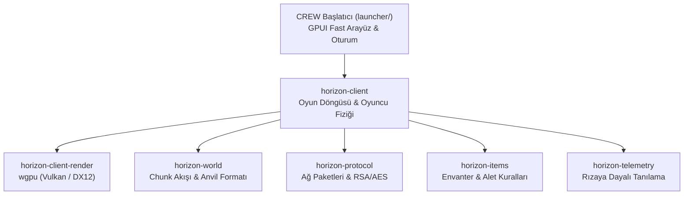

# CREW Client — Kod Tabanı ve Sistem Mimarisi

Bu belge, CREW Client'ın modüler kod yapısını, Rust tabanlı oyun motoru katmanlarını, başlatıcı mimarisini ve test/parite doğrulama mekanizmasını açıklamaktadır.

---

## 1. Genel Mimari Yapı

CREW Client iki ana bileşenden oluşur:
1. **CREW Başlatıcı (`launcher/`):** Yüksek kare hızında çalışan, düşük gecikmeli GPUI Fast kütüphanesi üzerine kurulu yerel masaüstü arayüzü.
2. **CREW Motor Katmanları (`crates/`):** Minecraft Java Edition 1.21.11 ile tam uyumlu çalışan, paralel iş parçacıklı Rust oyun motoru kütüphaneleri.

---

## 2. Kütüphaneler ve Sorumluluk Alanları

| Dizin / Kütüphane | Sorumluluk Alanı | Temel Dosyalar |
|---|---|---|
| `launcher/` | Masaüstü başlatıcı arayüzü, Microsoft OAuth2 giriş, Modrinth mod arama, sunucu durumu, ayarlar. | `src/main.rs`, `src/home.rs`, `src/auth.rs`, `src/settings.rs` |
| `crates/horizon-client/` | Ana oyun döngüsü (`tick`), oyuncu hareketi, çarpışma algılama, varlık mantığı ve istemci durumu. | `src/game.rs`, `src/net.rs`, `src/save.rs`, `src/mobs.rs` |
| `crates/horizon-client-render/` | Modern wgpu tabanlı render motoru. Vulkan ve DirectX 12 üzerinde çalışan pürüzsüz aydınlatma ve blok çizimi. | `src/gfx.rs`, `src/hud.rs`, `src/chunk.rs`, `src/options.rs` |
| `crates/horizon-client-input/` | Klavye, fare, pencere yönetimi ve düşük gecikmeli ham girdi işleme. | `src/window.rs`, `src/input.rs` |
| `crates/horizon-world/` | Dünya oluşturma (worldgen), Anvil formatında bölge kaydetme/yükleme, NBT ayrıştırma. | `src/worldgen.rs`, `src/region.rs`, `src/nbt.rs` |
| `crates/horizon-protocol/` | Minecraft Java ağ protokolü, paket kodlayıcı/çözücüleri, el sıkışma ve sunucu şifrelemesi. | `src/packets/`, `src/rsa.rs`, `src/crypto.rs` |
| `crates/horizon-items/` | Eşya tanımları, alet dayanıklılığı, tarifler, ganimet tabloları ve zırh özellikleri. | `src/items.rs`, `src/enchant.rs` |
| `crates/horizon-command/` | Oyun içi komut ayrıştırma, bağımsız değişken doğrulama ve çalıştırma ağacı. | `src/args.rs`, `src/selector.rs`, `src/tree_*.rs` |
| `crates/horizon-telemetry/` | Kullanıcı onayına tabi, tamamen şeffaf hata ve başarım raporlama mekanizması. | `src/consent.rs`, `src/outbox.rs`, `src/upload.rs` |

---

## 3. Oyun Döngüsü ve İş Parçacığı Modeli

CREW Client, standart Java istemcisinin aksine tek bir ana iş parçacığına bağımlı değildir:
- **Mantık Döngüsü (20 TPS):** Oyuncu fiziği, blok etkileşimleri ve varlık güncellemeleri sabit 50 milisaniyelik adımlarla çalışır.
- **Render Döngüsü (Sınırsız FPS):** Grafik motoru, ekran yenileme hızına (Hz) tam uyum sağlayacak şekilde bağımsız kare hızlarında çalışır.
- **Paralel Chunk Yükleme:** Dünya parçaları ve örgü (mesh) hesaplamaları arka plan havuzundaki çalışan iş parçacıklarına (worker threads) dağıtılır; böylece hareket ederken anlık takılmalar (stutter) yaşanmaz.

---

## 4. Parite Testleri ve Doğrulama

CREW Client, standart Minecraft Java Edition davranışı ile birebir uyumluluğu korumak amacıyla geniş kapsamlı otomatik test dizilerine sahiptir:
- **Birim Testleri:** `cargo test` ile motor fonksiyonlarının doğruluğu denetlenir.
- **Parite Test Takımı (`tools/parity.py`):** Blok güncellemeleri, kırmızı taş mantığı, dünya oluşturma ve hareket fiziği standart Java sürümü ile karşılaştırılarak test edilir.

---

*CREW Network © 2026 — [client.crewnetwork.space](https://client.crewnetwork.space/)*
